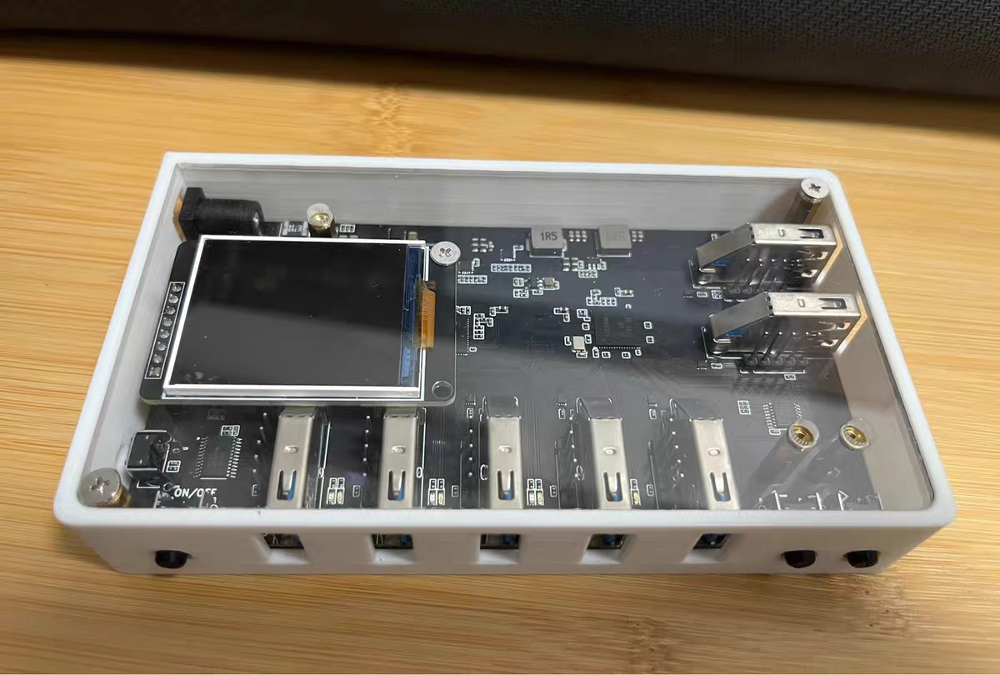

# power-hub

USB Hub 电源管理与可视化上位机：对 1 转 7 USB3.0 Hub 的 7 个通道做独立电源控制与实时遥测。



## 功能特性

- **通道电源控制**：每通道独立开/关；电源循环（power cycle）远程重启死机 USB 设备。
- **实时遥测**：每通道电压 / 电流 / 功率，默认 0.5 秒电流轮询 + 迷你曲线；状态轮询默认 3 秒、间隔可配置（0.5s~10s 或禁用），感知面板手动操作。
- **设备枚举**：经 Windows 设备树（cfgmgr32）枚举每个通道口接入的 USB 设备（名称 / VID:PID / 所在 hub 端口），通道断电后枚举自然消失。
- **演示模式**：内置虚拟 hub（协议参考模拟器），无硬件即可体验全部 UI。
- **本地 API**：上位机内置 `127.0.0.1:8756` HTTP + WebSocket API（自定义请求头 `X-Power-Hub: v1`），供 AI 技能复用；无 token、无落盘（见 ADR-0003）。
- **日志**：tauri-plugin-log 落盘 + 循环覆盖，`--verbose` 记录串口原始帧。

## 技术栈

- **前端**：React 18 + TypeScript + Vite，Tauri 2 WebView。
- **后端**：Rust（Tauri 2），串口经 `serialport`，USB 设备树枚举经 `windows-rs`。
- **协议**：独立 crate `protocol`（二进制帧 + XOR 校验，含虚拟 hub 参考实现），规范见 [docs/protocol.md](docs/protocol.md)。

## 构建与运行

前置：Node.js（npm）与 Rust（MSVC 工具链，Windows 目标）。

```bash
npm install
npm run tauri dev      # 开发运行
npm run tauri build    # 打包（产物在 src-tauri/target/）
```

打包发布时把 `docs/调试.bat` 与 `docs/调试说明.txt` 放到 exe 同目录，用于最终用户排查问题。

## AI 技能

[skills/power-hub/](skills/power-hub/SKILL.md) 是面向 AI 代理（ZCode / Claude 等）的控制技能：`scan / status / on / off / cycle / watch`。优先走本地 API，不可用时直连串口（pyserial，按 CH340 控制口过滤）。

## 硬件适配档案

hub 主控为 TI TUSB8041（高速 / SuperSpeed 双半树），控制串口为 CH340；实测 VID/PID 魔术字集中维护在 `src-tauri/src/magic.rs`，设备树枚举适配见 `src-tauri/src/usb.rs`。

## 仓库导览

| 位置 | 内容 |
| --- | --- |
| [docs/protocol.md](docs/protocol.md) | 上位机 ↔ hub 二进制帧协议规范 |
| [docs/adr/](docs/adr/) | 架构决策记录（协议、枚举、本地 API、演示模式等） |
| [GLOSSARY.md](GLOSSARY.md) | 领域词汇表 |
| [AGENTS.md](AGENTS.md) · [docs/agents/](docs/agents/) | AI 代理协作约定与 issue tracker / 分诊机制 |
| [skills/power-hub/](skills/power-hub/SKILL.md) | AI 控制技能 |
| [src-tauri/crates/protocol/](src-tauri/crates/protocol/) | 协议 crate 与虚拟 hub 参考实现 |

## 许可

[MIT](LICENSE)
